## 信号（signal）

> 信号是unix和linux操作系统经典的消息机制，主要用途是处置进程（利用信号杀死 挂起进程 ） 也可以在开发中使用信号机制 例如信号捕捉 让信号绑定一个行为（捕捉函数） 信号递达 系统自动调用对应函数

- 系统支持的信号 kill -l #ubuntu系统支持的所有信号列表

> 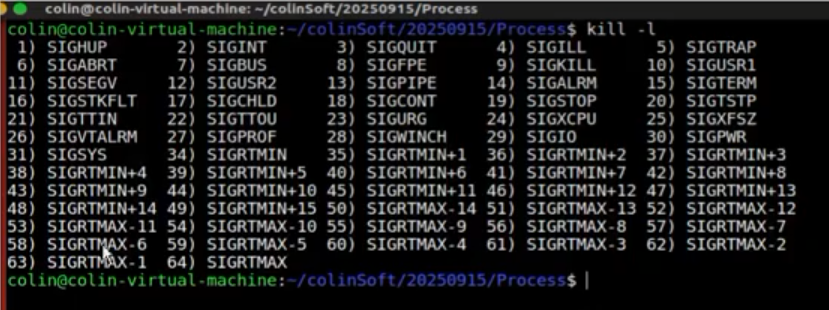

- 两类信号
    - 1-31 unix 经典信号
    - 32-33被隐藏了 不提供给用户使用 保留给NPTL线程库使用 用户无法直接使用
    - 34-64 自定义信号

### 系统中信号的集中触发方式

> 在终端bash中 前台进程是唯一的 +标识 S+ R+

1.  终端组合按键触发信号
    1\. ctl+c 系统触发SIGINT(2)杀死前台进程
    2\. ctl+\ 系统触发SIGQUIT(3) 杀死前台进程
    3\. ctl+z 系统出发SIGTSTP(20)，挂起前台进程

- 终端组合件触发信号 对后台进程无效
    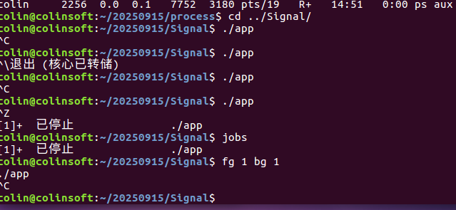
    终端组合按键如何被解析和处理

> 线路规划识别终端组合按键 完成后续操作
> 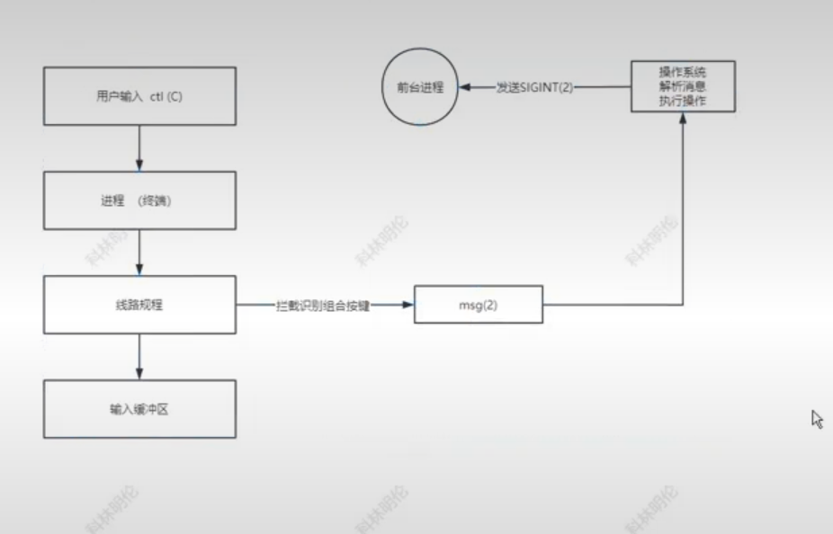

2.  命令触发信号

```bash
    kill -signo pid(-pgid) #向任意进程或任意组 发送信号杀死进程 可能会因为权限不足而失败 必须对目标进程或组有足够的权限
```

3.  函数触发信号

```bash
#include<signal.h>
kill(pid_t pid,pid_t signo);//向任意进程或组发送任意信号 函数版本
raise(pid_t signo); //向当前进程发送任意信号
void abort(void); //向当前进程发送固定的SIG_ABRT信号
sigqueue(pid_t pid ,pid_t signo,union sigval val);//向任意进程发送任意信号，并且携带union信息包 支持ipc
```

4.  硬件异常产生信号

- 段错误，进程中内存访问异常 例如对只读内存进行写操作， 会触发段错误 系统发送SIGSEGV(11)杀死进程
    
- 总线错误 内存的越界访问 访问野地址 系统会发送SIGBUS(7),杀死目标进程
    
- 浮点数例外 使用cpu计算机 产生计算异常 系统发送SIGFPE(8)杀死目标进程
    

5.  软条件产生信号
    管道读端关闭 写端写管道 满足软条件 系统发送SIGPIPE(13)杀死写端进程
    使用alrm定时器 如果定时到时 系统向进程发送 SIGLRM(14) 杀死定时进程

```c
    unsigned int alarm(unsigned int seconds);//参数为定时的秒数 返回值为未定时够的秒数 返回0代表成功 返回>0代表定时失败 有未定时够的时长
```

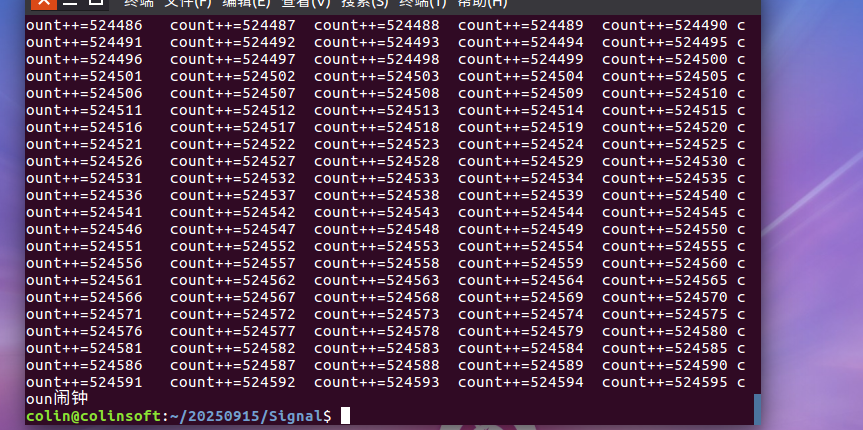
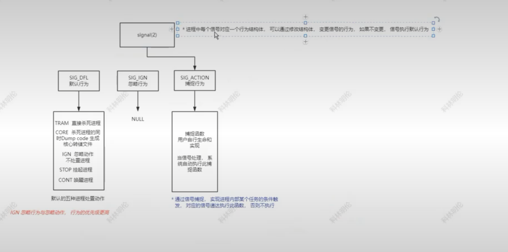

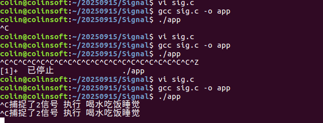

* 信号的传递过程， 以及如何实现阻塞信号/屏蔽信号

> 信号传递过程图解：
> 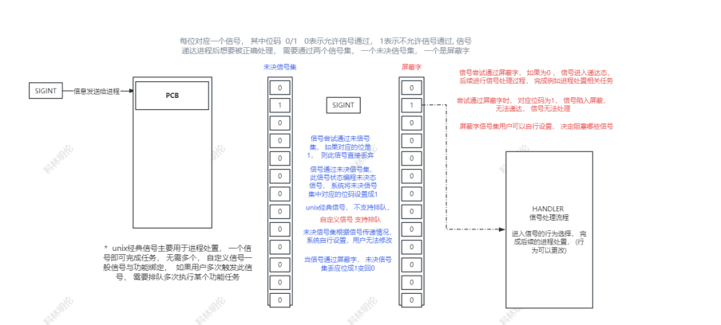

> 对进程信号屏蔽字进行设置和替换， 实现屏蔽阻塞信号的效果， 让信号失效
进程默认带有屏蔽字， 开发者需要自行定义一个新， 而后进行设置， 最后用自定义的对进程原有的进行替换即可
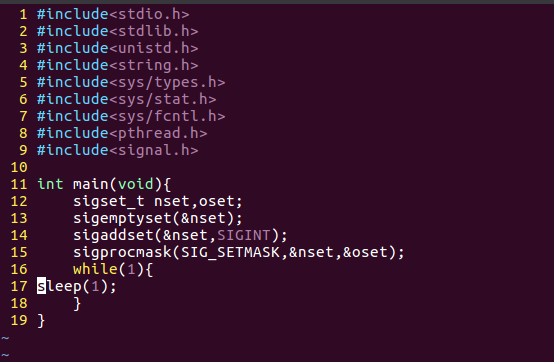
```c
#include<signal.h>
sigset_t //信号集类型,无论是未决信号集还是屏蔽字都是这个类型的
sigemptyset(sigset_t * nsset);//初始化函数， 将nset中所有位初始化成0
sigfillset(sigset_t * nset);//初始化， 将nset中所有位初始化成1
sigaddset(sigset_t * nset ,int signo); //设置函数， 对nset信号集中， signo信号位设置1
sigdelset(sigset_t * nset,int signo);//设置函数， 对nset信号集中， signo信号位设置0
int bit = sigismember(sigset_t * nset,int signo); //获取nset集中 signo信号的位码，通过函数直接返回 (查看信号集中某个信号的位码)
SIG_SETMASK , 这种替换方式，直接让nset替换覆盖进程原有信号集

```
* 想要查看进程信号的屏蔽情况 查看未决 他是动态变更的 因为信号为递达 为0 信号递达后系统设置为1
```c
sigpending(sigset_t * pset);//获取传出 进程未决信号集 传出到pset里
```
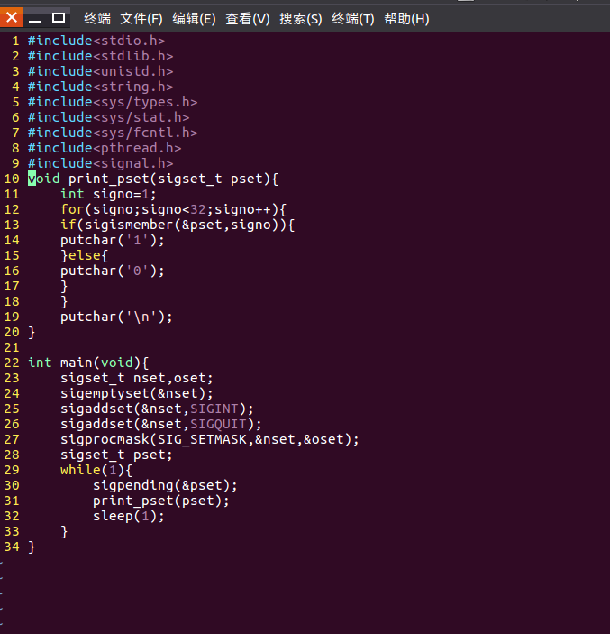

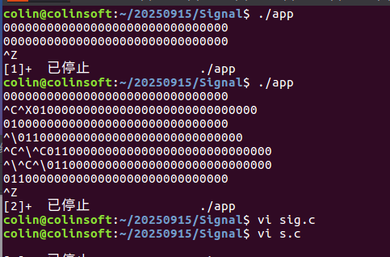
### 信号失效的3种方式， 以及区别
* 信号忽略， 通过修改信号的行为，改为SIG_IGN , 忽略的信号已递达， 但是处理动作为NULL
* 信号捕捉， 自定义信号行为， 让其从默认动作变为自定义动作， 信号失效 , 捕捉的信已递达， 因为自定义动作失效
* 信号屏蔽， 修改进程的信号屏蔽， 让信号阻塞在屏蔽字之间， 无法递达， 实现失效的效果 , 信号未递达， 临时屏蔽， 信号并没有消失， 只要解除屏蔽， 信号递达依然执行默认动作， 杀死挂起进程
### 高权信号
* 如果所有的信号都能通过 屏蔽、忽略、捕捉让其失效， 系统还安全吗？
	* 系统提供一组2个信号 SIGKILL(9) 杀死 SIGSTOP(19) 挂起, 这两个信号无法被屏蔽、忽略和捕捉，
```c
#此代码屏蔽11号信号 SIGSEGV(段错误信号)
int main(void)
如果进程执行过程中触发硬件异常， 系统发送信号， 那进程所属用户的权限是不能屏蔽忽略捕捉
此信号的， 因为用户进程权限不足， 信号的权限更高， 依然会杀死进程, 以后屏蔽信号还要考虑
权限， 拷贝进程的权限， 以及发出者权限
信号处理时捕捉函数是如何被系统调用的以及层级转换
信号递达进程， 是被进程立即处理吗？ 还是延迟处理？
信号开发相关
使用信号使回收变为被动回收
使用信号技术，可以将僵尸进程的回收从主动回收变为被动回收， 传统直接使用wait或
waitpid都是主动回收， 无意义， 给父进程额外的开销
信号回收(被动回收)
僵尸进程只有父进程能回收， 当子进程退出， 系统只给其父进程发送一个信号 SIGCHLD
使用信号捕捉 sigaction , 对SIGCHLD实现捕捉设定， 当信号递达进程， 系统自动调捕捉函
数，捕捉中完成回收处理
{
sigset_t nset,oset;
sigemptyset(&nset);
sigaddset(&nset,SIGSEGV);
sigprocmask(SIG_SETMASK,&nset,&oset);//实现屏蔽段错误信号
while(1)
sleep(1);
}
#gcc test.c -o app
./app （pid 3000）
kill -11 3000; //可以成功屏蔽信号, 11号信号无法杀死进程

```

```c
int main(void){
char * str = "9890890809123123";
sigset_t nset,oset;
sigemptyset(&nset);
sigaddset(&nset,SIGSEGV);
sigprocmask(SIG_SETMASK,&nset,&oset);//实现屏蔽段错误信号
str[0]='A'; //非法操作内存， 操作系统检测到硬件异常， 向进程发送11(SIGSEGV信号)， 进程
被杀死， 抛出 段错误（核心已转储）
printf("str %s\n",str);
}

```
> 如果进程执行过程中触发硬件异常，系统发送信号 那进程所属用户的权限是不能屏蔽忽略捕捉此信号的 因为用户进程权限不足 信号的权限更高 依然会杀死进程 以后屏蔽信号还要考虑权限 拷贝进程的权限 以及发出者权限
#### 信号处理时捕捉函数是如何被系统调用的以及层级转换
> 信号递达进程 是被进程立即处理吗 还是延迟处理？
> 

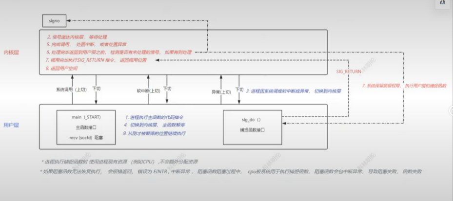

### 信号开发相关
* 使用信号使回收变为被动回收
	> 使用信号技术 可以将僵尸进程的回收从主动回收变为被动回收 传统直接使用wait或waitpid都是主动回收 无意义 给父进程额外的开销
	> 信号回收（被动回收）
	* 僵尸进程只有父进程能回收 当子进程退出 系统只能给其父进程发送一个信号 SIGCHLD
	* 使用信号捕捉sigaction 对SIGCHLD实现捕捉设定 当信号递达进程 	系统自动调捕捉函数 捕捉中完成回收处理
	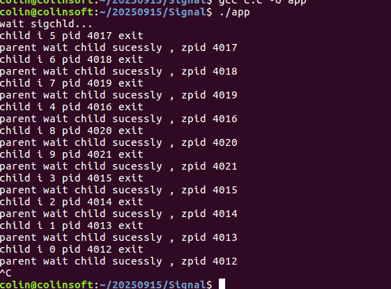
* 信号实现进程间通信IPC 