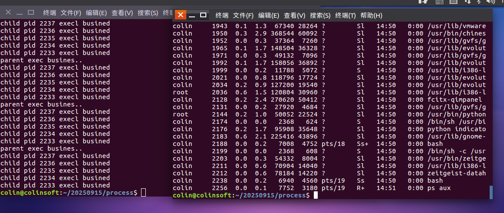

#### 孤儿进程
* 孤儿进程是什么？
	* 父子进程中 父进程先于子进程退出 子进程就变成孤儿进程 当进程变成孤儿进程后 系统托管进程生效 孤儿进程的父进程自动变更为托管进程 托管进程负责回收 upstart/user(托管进程)
* 孤儿进程的危害
	* 孤儿进程是（异常进程），残留在系统中不处理会影响新进程的创建与使用
	* 孤儿进程的危害是有弹性的 如果孤儿进程低开销执行 危害还能接受 如果孤儿进程持续申请系统资源 那么危害巨大
		* 孤儿进程早发现早处理（杀死孤儿进程）
* 孤儿进程如何处理？ signal 信号
	* 假设父进程是3000 有四个子进程3001 3002 3003 3004 怎么把这四个杀死
		* 利用匿名管道的特性 处理杀死孤儿进程 父进程作为读段管道 子进程作为管道写端 只要读端关闭 写端写数据被系统杀死（SIGPIPE）
		 
		* 信号处理 使用第三方检测进程  手动发送信号杀死孤儿进程 
	```bash
	ps ajx#此命令用于查看进程间关系 ppid pid pgid sid
	ps aux#进程详细信息
	