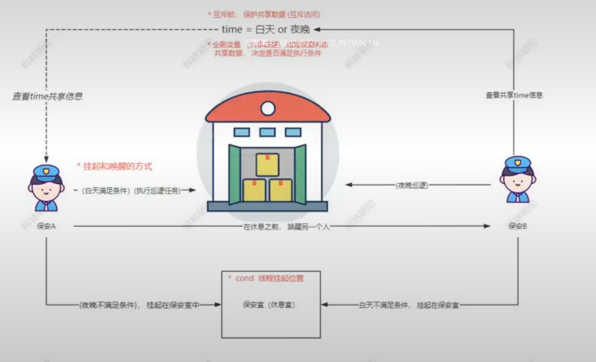
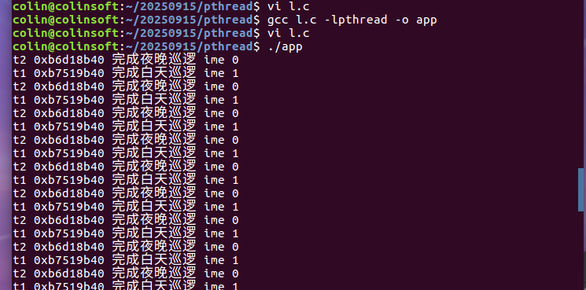
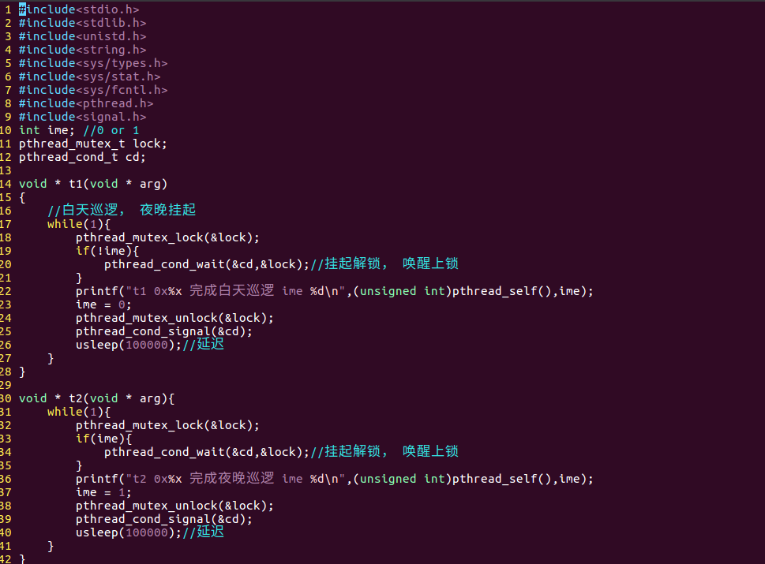
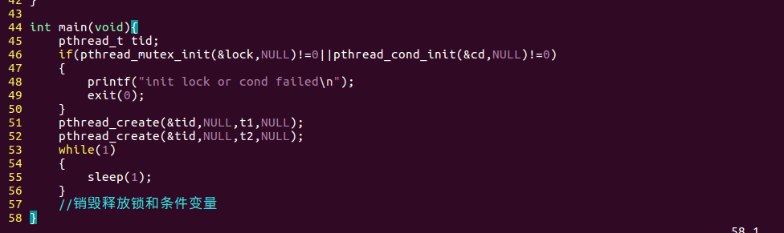
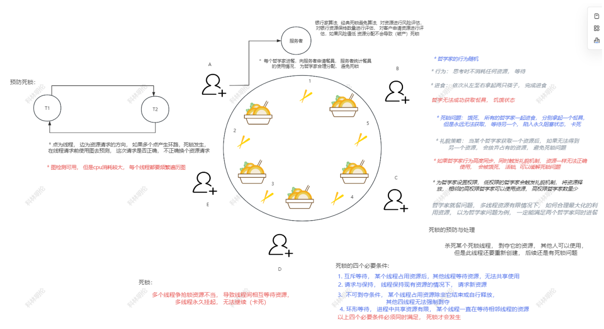

#### 线程安全2 
> 线程间的同步 控制 调度问题  多线程执行过程中 开发者可能需要 调度控制线程 让线程按开发者规划的方式去执行 满足条件可以执行时则唤醒(执行) 不满足时将线程等待挂起 这类线程控制技术(信号量)Linux Unix操作系统使用条件变量(cond)

* 线程同步 线程的控制调度(条件变量机制)
	* 条件变量
	 > 线程可以受控制 挂起唤醒线程 避免线程的忙等待问题(不满足执行条件时不消耗cpu) 

共享数据(多线程执行的判断数据)
挂起位置(线程可以通过函数挂起在cond里),其他线程也可以唤醒线程

```c
	pthread_cond_t cd;//条件变量类型,线程可以挂起在此位置,被唤醒
	cd = PTHREAD_COND_INITIALIZER;//
	条件变量静态初始化pthread_cond_init(&cd,NULL);//条件变量动态初始化(申请内存)
	pthread_cond_destory(&cd);//销毁释放内存
```
唤醒挂起的方法
```c
pthread_cond_wait(&cd);//将当前调用线程挂起在cd条件变量中
cond_wait函数 分为挂起执行和唤醒执行 挂起时可以指定解锁互斥锁 被唤醒后继续执行cond_wait,上锁互斥锁
pthread_cond_signal*7(&cd);
//唤醒一个挂起在cd中线程
pthread_cond_broadcast(&cd);//唤醒所有挂起在cd中线程
```



* 使用while代替if对共享数据进行判断
	* 线程被唤醒后可以再次判定条件 避免错误的唤醒导致执行后续任务
* pthread_cond_signal函数 唤醒的线程数量不一定是1 而是小于等于cpu数量 可能引发错误的环形
* 条件变量的数量屈居与执行条件的数量 上述例子 条件变量的数量应该是2 不同的任务的线程挂起在不同条件变量上
 * 死锁问题
	 * 哲学家就餐
	 * 