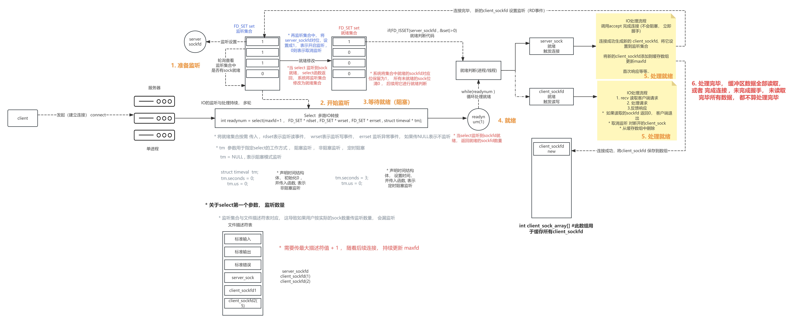
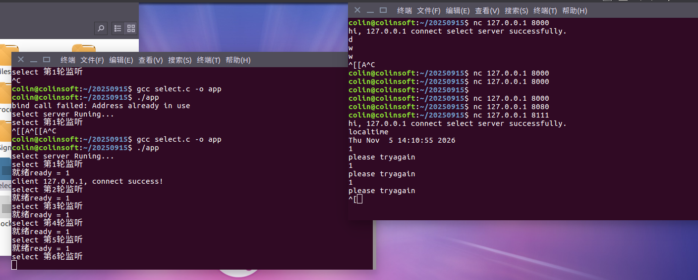

#### 多路IO转接 多路IO复用
> 对于一个服务器而言 或者说对于网络应用而言 IO处理时非常重要的 因为他有大量的连接 也有各种各样的socket要去处理 这个技术就是socket 监听技术 帮我们监听socket上的事件 当我们监听了这个事件 触发了之后我们就可以去处理后续 就是socket监听技术
> 作为服务器软件 大量的tcp连接 服务器中 网络IO处理(socket处理)的需求很大,需要一种技术可以帮助开发者 (进程)监听大量的socket 当监听的socket就绪后 进程在负责处理socket(accept完成三次握手 recv读取数据) 这个socket监听技术就是多路IO转接技术 经典的sockfd监听技术
* socket_fd什么需要被监听
	* sockfd中监听的三个数据
	* 读事件: 当有数据递达sockfd缓冲区(sock缓冲区有待读取数据)对应sockfd的读事件触发
		* server_sockfd,如果监听服务器的socket读事件触发 标识有连接请求 
		* client_sockfd 如果监听client_sock读事件触发 标识客户端消息递达需要读取
	* 写事件:有数据在socket缓冲区 未发送完毕 写事件触发
	* 异常事件:sockfd访问异常 触发异常事件 读或写时出现异常
	> 多路IO转接技术 只负责sockfd的事件监听 sockfd的处理依然由进程或线程负责 与IO转接技术无关
	* Select
	> 
```c
#include<sys/select.h>
int select(max_fd+1,FD_SET* rdset,FD_SET* wrset,FD_SET* errset,struct timeval * tm)//可以监听sockfd默认采用轮询监听
```
> FD_SET监听集合类型 最大值为1024 这个属于硬限制无法修改
> * 可以监听有效客户端sockfd只有1020个 减去serversock描述符 和3个默认描述符
```c
FD_ZEOR(&set);//将监听集合所有位初始化0
FD_SET(int sockfd,&set);//将sockfd在set集合中对应位设置1 启动监听
FD_CLR(int sockfd,&set);//将sockfd在set集合中对应位设置0 取消监听
code=FD_ISSET(int sockfd,&set);//获取set集合中sockfd对应位的位码并返回
```
* 使用select时 需要声明set oset 两个集合 进行传入与传出分离 避免就绪后直接篡改监听集合	

* Epool